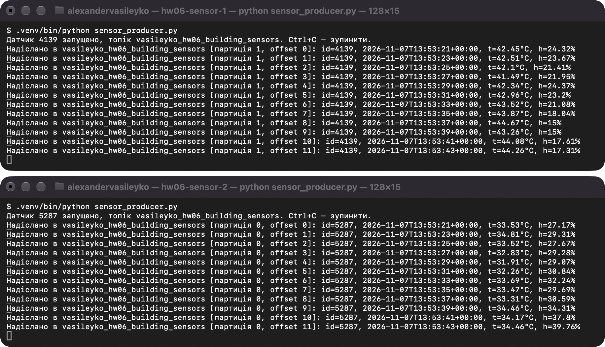
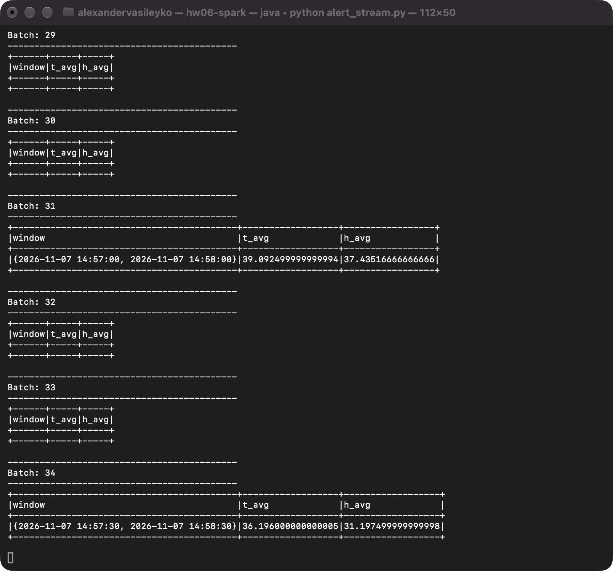
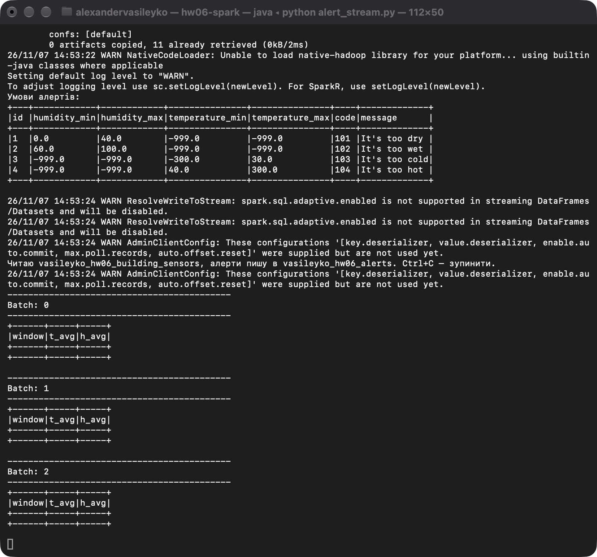
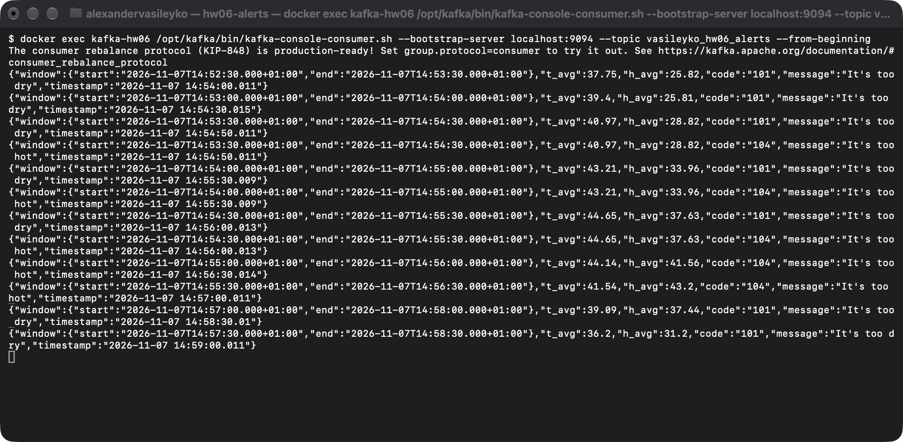

# goit-de-hw-06 — Spark Streaming. Алерти за даними IoT-датчиків

Виконав: Олександр Василейко

**Середовище:** PySpark 3.5.9, OpenJDK 17, Python 3.12, Apache Kafka 4.3.2 (KRaft, Docker).

**Конвеєр:** датчики → топік `vasileyko_hw06_building_sensors` → Spark: ковзне вікно і середні значення → cross join з умовами з CSV і фільтрація → топік `vasileyko_hw06_alerts`.

## Запуск

```bash
uv venv --python 3.12 && uv pip install -r requirements.txt
docker compose up -d
.venv/bin/python create_topics.py

# Кожна команда в окремому терміналі, датчиків — два або більше
.venv/bin/python sensor_producer.py
.venv/bin/python sensor_producer.py
JAVA_HOME=/opt/homebrew/opt/openjdk@17 .venv/bin/python alert_stream.py
docker exec kafka-hw06 /opt/kafka/bin/kafka-console-consumer.sh \
  --bootstrap-server localhost:9094 --topic vasileyko_hw06_alerts --from-beginning
```

Перевірка логіки без брокера: `JAVA_HOME=/opt/homebrew/opt/openjdk@17 .venv/bin/python test_alert_stream.py`.

Якщо брокер створено заново, перед запуском треба видалити `checkpoints/`: там збережено offset-и старих топіків.

На скриншотах датчики показують час в UTC (13:53), а Spark — місцевий (14:53, UTC+1).

## 1. Генерація даних сенсорів

Кожен запуск [sensor_producer.py](sensor_producer.py) — окремий датчик зі своїм `id`. Кожні 2 секунди він надсилає `id`, `temperature`, `humidity` і `timestamp`. На скриншоті два одночасні запуски, датчики 4139 і 5287: час їхніх повідомлень перетинається.

Показники змінюються плавно. Незалежні випадкові значення за хвилину усереднювалися б приблизно до 35 °C і 50 %, тобто в норму, і алертів майже не було б.



## 2. Агрегація даних

Функція `window_averages` в [alert_stream.py](alert_stream.py): ковзне вікно 1 хвилина, крок 30 секунд, watermark 10 секунд. Середні `t_avg` і `h_avg` рахуються за всіма датчиками у вікні.

Режим виводу — `append`: вікно виходить один раз, коли watermark його закрив. Тому середнє пораховане за повним вікном, а алерт не повторюється на кожному мікробатчі. Порожні батчі на скриншоті — це проміжки між закриттям вікон.



## 3. Параметри алертів

Умови лежать в [alerts_conditions.csv](alerts_conditions.csv) і читаються на старті застосунку. Значення `-999` означає, що межа для цього алерту не використовується.

Щоб змінити критерії, достатньо поправити файл і перезапустити застосунок. Код не змінюється, а стан вікон відновлюється з `checkpoints/`. Це перевірено: правило, додане в CSV, спрацювало лише у вікнах, закритих після перезапуску, а вікна, що припали на перезапуск, не втратили показників.



## 4. Визначення алертів

Функція `find_alerts`: `crossJoin` середніх з умовами і фільтр за межами (включно), який пропускає межі `-999`. Одне вікно може дати кілька алертів, кожен окремим повідомленням.

Результат цього запуску:

| Початок вікна | `t_avg` | `h_avg` | Алерти |
|---|---|---|---|
| 14:53:30 | 40.97 | 28.82 | 101 і 104: сухо і жарко |
| 14:55:00 | 44.14 | 41.56 | 104: жарко |
| 14:56:00 | 38.92 | 41.84 | немає: обидва показники в нормі |
| 14:57:00 | 39.09 | 37.44 | 101: сухо |

## 5. Запис у Kafka-топік

Функція `to_kafka_messages` формує JSON, а Spark пише його у `vasileyko_hw06_alerts`. На скриншоті вміст топіка, прочитаний `kafka-console-consumer`. Вікон 14:56:00 і 14:56:30 у ньому немає, бо вони були в нормі.

```json
{
  "window": {
    "start": "2026-11-07T14:53:30.000+01:00",
    "end": "2026-11-07T14:54:30.000+01:00"
  },
  "t_avg": 40.97,
  "h_avg": 28.82,
  "code": "104",
  "message": "It's too hot",
  "timestamp": "2026-11-07 14:54:50.011"
}
```


